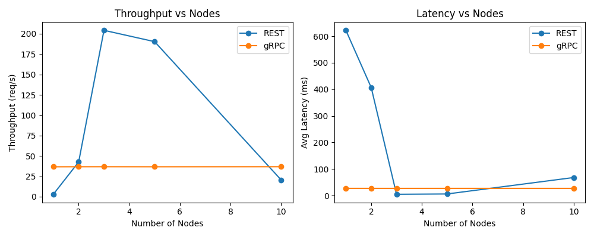

# Raft & Two-Phase Commit

Containerized implementations of two consensus protocols, **Raft** and **Two-Phase Commit (2PC)**, with nodes talking over gRPC. The repo also includes a layered REST system and a gRPC microservices system, benchmarked against each other.

**Stack:** Python · gRPC / Protocol Buffers · Docker Compose

## What's inside

| Path | Contents |
|---|---|
| [`consensus/raft`](Distributed-Systems-main/consensus/raft) | 5-node Raft cluster: leader election, heartbeats, log replication |
| [`consensus/two_pc`](Distributed-Systems-main/consensus/two_pc) | 2PC coordinator + participants, with a configurable abort vote to simulate failures |
| [`microservices-grpc`](Distributed-Systems-main/microservices-grpc) / [`layered-rest`](Distributed-Systems-main/layered-rest) | The same system built as gRPC microservices and as layered REST |
| [`benchmarking`](Distributed-Systems-main/benchmarking) | Throughput/latency benchmark across 1–10 nodes, with plots |

## Quickstart

```bash
cd Distributed-Systems-main

# Raft: start a 5-node cluster and run the automated tests
docker compose -f consensus/raft/docker-compose.yml up --build -d
python raft_automated_tests.py

# 2PC: start the cluster and run a transaction
docker compose -f consensus/two_pc/docker-compose.yml up --build -d
python -m consensus.two_pc.manager localhost:6100 --participants 1 2 3 4
```

Set `DEFAULT_VOTE=abort` on a participant to exercise the abort path. Full instructions are in [`Distributed-Systems-main/ReadMe.md`](Distributed-Systems-main/ReadMe.md).

## Benchmark



Raw numbers: [`results.csv`](Distributed-Systems-main/benchmarking/experimental/results.csv)
